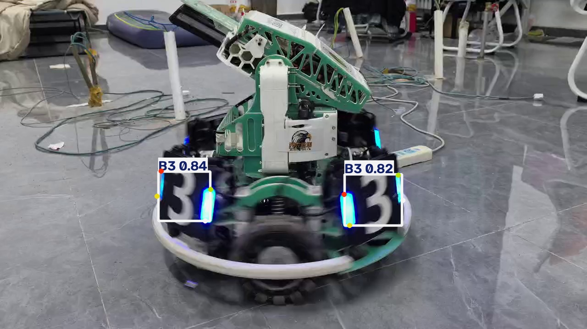

# YOLO26n-pose 装甲板模型：导出 ONNX 与推理对比

本仓库完成作业 **“将 `.pt` 模型权重转换为其他格式，并用导出模型完成推理、与原始模型对比”**。

模型来自上一次作业：YOLO26n-pose 装甲板关键点模型（6 个类别、每个目标 4 个关键点）。本次把它从
PyTorch 的 `.pt` 导出为 ONNX，用同一段视频分别推理，比较两者的文件大小、推理速度、检测数量与检测效果。

---

## 1. 本次使用的 YOLO 模型版本

| 项目 | 内容 |
| --- | --- |
| 模型结构 | `yolo26n-pose.yaml`（YOLO26，n 尺度，Pose/关键点任务） |
| 训练框架 | Ultralytics **8.4.178** |
| 参数量 | 2,447,934（推理时融合后）；2,704,788（未融合） |
| 输入尺寸 | 640 × 640 |
| 类别数 | 6：`B1 B2 B3 R1 R2 R3`（装甲板数字与颜色） |
| 关键点 | 4 个/目标，`kpt_shape = [4, 2]`（只有 x,y，没有关键点置信度） |
| 权重文件 | `models/best.pt`（5.62 MB） |

---

## 2. 仓库结构

```
YOLO-Export-Inference/          （本地目录 F:\PythonProject2）
├── README.md                   本文件
├── requirements.txt            依赖清单
├── export.py                   导出脚本：.pt → .onnx
├── inference.py                推理脚本：加载 .pt 或 .onnx，输出带标注的结果视频
├── compare.py                  对比脚本：自动测量大小/耗时/检测数，生成报告与对比图
├── bench.py                    单模型纯前向测速（独立进程，供 compare.py 调用）
├── comparison.md               自动生成的对比报告
├── models/
│   ├── best.pt                 原始权重
│   └── model.onnx              导出的 ONNX 模型（9.72 MB）
├── videos/
│   └── experiment_1.mp4        测试视频（749 帧，1280x720，30 FPS，约 25 秒）
├── results/
│   ├── pt_result.mp4           原始 .pt 模型的推理结果视频
│   ├── onnx_result.mp4         导出 .onnx 模型的推理结果视频
│   ├── pt_frame.jpg            结果截图（.pt）
│   ├── onnx_frame.jpg          结果截图（.onnx）
│   └── compare_side_by_side.jpg 左右并排对比图
└── legacy/                     早期脚本（导出/验证的初始版本），不影响复现，可忽略
```

> 两个模型文件合计约 15 MB，普通 Git 仓库可以直接提交，不需要 Git LFS。

---

## 3. 运行环境与依赖

| 项目 | 版本 |
| --- | --- |
| 操作系统 | Windows 11 家庭版（64 位） |
| CPU | Intel Core i7-14650HX（24 逻辑核心） |
| Python | 3.14.6 |
| PyTorch | 2.14.1+cu126（本次推理**统一用 CPU**） |
| Ultralytics | 8.4.178 |
| ONNX / ONNX Runtime / onnxslim | 1.23.2 / 1.31.1 / 0.1.98 |
| OpenCV / NumPy | 5.0.0 / 2.4.6 |
| imageio-ffmpeg | 0.7.0（提供 ffmpeg，用于 H.264 编码） |

安装依赖：

```bash
pip install -r requirements.txt
```

> 对比实验要求“同一硬件、同一环境”，所以两个模型都在 **CPU** 上推理。`onnxruntime` 装的是 CPU 版；
> `torch` 虽然带 CUDA，但脚本里把 `CUDA_VISIBLE_DEVICES` 设成了 `-1`，保证不会被显卡加速干扰。

---

## 4. 导出方法（`export.py`）

```bash
python export.py
```

导出参数：

| 参数 | 值 | 说明 |
| --- | --- | --- |
| `format` | `onnx` | 目标格式 |
| `imgsz` | 640 | 与训练/推理一致的输入尺寸 |
| `opset` | 12 | ONNX 算子集版本，兼容性最好（OpenCV DNN / TensorRT / 老版本 onnxruntime 都支持） |
| `simplify` | `True` | 用 onnxslim 合并冗余节点 |
| `dynamic` | `False` | 固定 640×640 输入，部署最稳 |
| `device` | `cpu` | 导出只是“翻译”，CPU 更稳 |

导出原理：`ultralytics` 用一个 640×640 的假输入让模型跑一遍前向，`torch.onnx.export` 把每个算子
“录制”成 ONNX 节点，连同权重一起写成计算图，最后用 `onnxslim` 精简。产物为
`models/model.onnx`，输入 `images [1,3,640,640]`，输出 `output0 [1,18,8400]`
（18 = 4 个框参数 + 6 个类别分数 + 4×2 个关键点坐标，8400 = 80²+40²+20² 个候选框）。

---

## 5. 推理方法（`inference.py`）

```bash
# 用导出的 ONNX 模型推理
python inference.py --model models/model.onnx --source videos/experiment_1.mp4 --output results/onnx_result.mp4

# 用原始 PyTorch 模型推理
python inference.py --model models/best.pt --source videos/experiment_1.mp4 --output results/pt_result.mp4
```

常用参数：

| 参数 | 默认值 | 说明 |
| --- | --- | --- |
| `--model` | `models/model.onnx` | 自动识别 `.pt` / `.onnx` |
| `--source` | `videos/experiment_1.mp4` | 输入视频 |
| `--output` | `results/onnx_result.mp4` | 输出视频（H.264 + 原音轨） |
| `--conf` | 0.25 | 置信度阈值 |
| `--iou` | 0.7 | NMS 的 IoU 阈值 |
| `--imgsz` | 640 | 推理输入尺寸 |
| `--device` | `cpu` | `cpu` / `0` |
| `--max-frames` | 0 | 只处理前 N 帧（调试用） |

两个模型走的是**同一套预处理、后处理、NMS 和画图代码**（都交给 ultralytics），
这样对比才公平。

---

## 6. 推理结果截图

原始 `.pt` 模型（左）与导出 `.onnx` 模型（右）在同一帧上的结果：

| 原始 `.pt` | 导出 `.onnx` |
| --- | --- |
|  |  |

左右并排对比图：`results/compare_side_by_side.jpg`（两组检测框、类别、置信度、4 个关键点完全重合）。

完整结果视频：`results/pt_result.mp4`、`results/onnx_result.mp4`。

---

## 7. 对比结果

> 完整报告见 [`comparison.md`](comparison.md)，由 `python compare.py` 自动生成。

| 对比项目 | 原始 `.pt` 模型 | 导出后的模型（`.onnx`） |
| --- | --- | --- |
| 模型格式 | `.pt`（PyTorch 序列化对象） | `.onnx`（ONNX 标准计算图） |
| 模型文件大小 | 5.62 MB | 9.72 MB（1.73 倍） |
| 推理耗时（纯网络，单帧，p10） | 46.9 ms | 14.5 ms |
| 推理速度（纯网络） | 21.3 帧/秒 | 69.1 帧/秒（**快 3.2 倍**） |
| 推理耗时（整段视频，含前后处理与画图） | 单帧中位 45.5 ms（总 38.5 s） | 单帧中位 30.1 ms（总 24.7 s） |
| 端到端速度（整段视频） | 19.5 帧/秒 | 30.3 帧/秒 |
| 检测目标数量（749 帧合计） | 622 个 | 619 个 |
| 有目标的帧数 | 429 / 749 | 429 / 749 |
| 类别分布 | B1=1，B2=3，B3=618 | B1=1，B2=3，B3=615 |
| 检测效果 | `results/pt_result.mp4` | `results/onnx_result.mp4` |

**精度一致性**（同一张 640×640 输入）：

| 指标 | 结果 |
| --- | --- |
| 原始输出张量最大误差 | 5.19e-04 |
| 检测框坐标最大误差 | **0.0000 像素** |
| 4 个关键点最大误差 | **0.0000 像素** |
| 单帧检测数量 | 完全一致 |

**差异原因分析**：

1. **体积变大（1.73 倍）**：`.pt` 只存参数 + 结构描述；`.onnx` 存 fp32 完整计算图 + 权重，
   所以更大。这不是模型变大，而是格式更“完整”。
2. **速度快 3.2 倍**：ONNX Runtime 对 CPU 做了算子融合、内存复用和更好的多线程调度；
   PyTorch 侧有 Python 调度开销。
3. **整段视频差距变小**（45.5 ms vs 30.1 ms）：视频推理还包含读帧、letterbox、NMS、画图和编码，
   这些两边一样，所以端到端差距被稀释。
4. **检测数 622 vs 619**：ultralytics 对 `.pt` 允许矩形输入（1280×720 → 384×640），
   对 `.onnx` 输入固定 640×640。两种填充方式让画面在画布中的位置略有不同，
   导致极少数置信度贴近 0.25 阈值的目标发生翻转（3 个）。有目标的帧数相同（429/749），
   主体检测一致；把输入统一到同一张 640×640 时，框与关键点误差为 0。

---

## 8. 遇到的问题及解决方法

1. **导出时报 `No module named 'onnx'`**：需要额外安装 `onnx`、`onnxruntime`、`onnxslim`。
   用国内镜像源时提示 `No matching distribution found`（镜像没同步新版本），改用默认 PyPI 解决。
2. **导出的 `.onnx` 比 `.pt` 还大**：正常现象，原因见第 7 节第 1 条。
3. **同一帧分别推理，框差了 0.3~0.5 像素**：一开始以为是导出精度丢了，实际是
   `.pt` 用矩形 letterbox（384×640）、`.onnx` 固定 640×640，画面在画布上的位置不同。
   把两边输入统一成同一张 640×640 后，误差变为 **0.0000 像素**。
4. **测速结果忽高忽低（46 ms 与 112 ms 交替）**：`import ultralytics` 会把环境变量
   `OMP_NUM_THREADS` 设为 `1`，子进程继承后 PyTorch 只能单线程跑。解决：测速子进程启动前
   清掉该变量，并且**每个模型单独开进程测**（避免 PyTorch 与 ONNX Runtime 的线程池互相抢占）。
5. **测速受机器上其他程序影响**：改为“预热 5 次 + 测量 50 次取第 10 百分位”，
   并各测两遍取较快值，数字才稳定。
6. **想把已画框的结果视频再拿去推理**：检测效果明显变差（整段检测数 619 → 75，置信度 0.89 → 0.51），
   因为画上去的框和文字被模型当成画面内容。**推理必须用干净的原视频**。
7. **控制台打印 `✓` 报 `UnicodeEncodeError`**：Windows 控制台默认 GBK 编码，改成纯文本输出即可。
8. **结果视频不好找**：早期版本只写到 `results/`，容易误以为原视频没被标注。现在结果统一放在
   `results/`，并在 README 里给出截图和路径。

---

## 9. 对不同模型格式的理解与结论

**`.pt`**：PyTorch 的序列化对象（pickle + 权重），能保存完整的模型结构，
但只有装了 PyTorch 的 Python 环境能读，跨语言/跨平台部署困难。

**`.onnx`**：开放的标准计算图格式（节点 + 张量 + 权重），与训练框架解耦。
任何实现了 ONNX 的引擎（ONNX Runtime、OpenCV DNN、TensorRT、OpenVINO、手机 NNAPI…）都能加载，
适合部署。

**结论**：

- 本模型导出 ONNX 后**精度无损**（框、关键点误差 0.0000 像素，单帧检测数完全一致）；
- 在 CPU 上**纯网络前向快约 3.2 倍**，整段视频端到端快约 1.6 倍；
- 代价是文件变大 1.73 倍，且输入形状固定为 640×640；
- 日常训练/调试用 `.pt` 更方便，**部署、交付、跨平台**用 `.onnx` 更合适；
- 若需要 GPU / 半精度 / 更低延迟，还可以继续导出 TensorRT、OpenVINO 等格式，
  导出流程与本次完全一样（只改 `format` 参数）。

---

## 10. 复现步骤

```bash
# 1. 安装依赖
pip install -r requirements.txt

# 2. 导出 ONNX（需要 models/best.pt）
python export.py

# 3. 一键对比：测速 + 两个模型分别推理 + 生成报告与对比图
python compare.py
```

`compare.py` 会依次产出：

- `results/pt_result.mp4`、`results/onnx_result.mp4`（带标注的结果视频）
- `results/pt_frame.jpg`、`results/onnx_frame.jpg`、`results/compare_side_by_side.jpg`
- `comparison.md`（含完整对比表格与差异分析）
